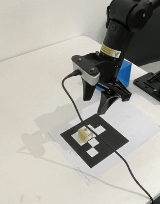
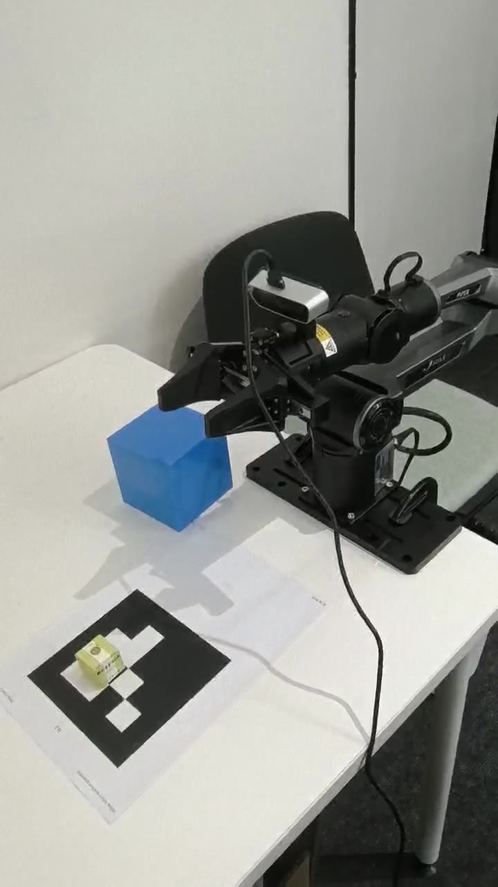
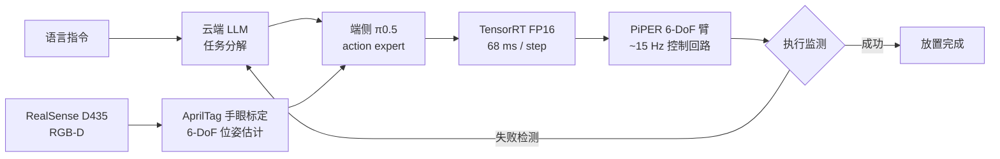

<h3 align="center">Real-Robot VLA Manipulation — π0.5 Fine-tuned</h3>

低资源真机平台上的 π0.5 微调与端侧部署：抓取 → 搬运 → 放置全流程闭环

  
  
  
  
  

---

| 真机抓取（原速，无剪辑） | 实验平台 |
|:---:|:---:|
|  |  |

> **完整演示**：[带任务字幕的完整视频（横屏）](assets/demo_landscape_captioned.mp4) · [原始视角（竖屏）](assets/demo_portrait_captioned.mp4) —— 真实拍摄、原速无剪辑，右上角带时间戳

## 概览 Highlights

在 **AgileX PiPER + Jetson Orin NX** 的低资源真机平台上，对 **π0.5** 做全流程微调与端侧部署：

- **全链路一人完成**：硬件搭建 → AprilTag 手眼标定 → 遥操作数据采集与清洗 → π0.5 微调 → TensorRT 端侧部署 → 真机评测
- 单步抓取放置成功率：**21% → 82%**（25 次 rollout，真机实测，非仿真）
- 未见物体泛化：**61%**；两步长程任务：**47%**（叠加失败检测重试后 **56%**）
- 端侧推理：**单步 68 ms**，action chunk 滚动执行，控制回路 **~15 Hz**
- 数据管线：遥操作 96 条 → 清洗保留 78 条，LeRobot 数据集格式

## 系统流程 Pipeline

## 平台 Platform

| 组件 | 说明 |
|---|---|
| 机械臂 | AgileX **PiPER**（6-DoF）+ 二指平行夹爪 |
| 相机 | Intel **RealSense D435**（RGB-D，腕装） |
| 标定 | **AprilTag (36h11)** 手眼标定，eye-in-hand 配置 |
| 端侧推理 | **Jetson Orin NX 16GB**，TensorRT FP16，单步 68 ms，action chunk（10 步）滚动执行 |
| 云端 | LLM 任务分解 + 失败检测与重试触发 |
| 训练硬件 | 2 × RTX 4090 |

## 数据 Data

- **物体**：自制木质方块 12 个，**6 类**（2 色 × 3 尺寸），含 2 个 held-out 未见类别
- **采集**：遥操作 **96 条**演示轨迹 → 时序对齐 + 剔除失败/丢帧后保留 **78 条**（有效率 81%），共约 2.1 小时、2.2 万帧
- **格式**：多视角 RGB-D 图像 + 关节角 / 夹爪状态 + 语言指令，**LeRobot** 数据集格式

## 训练 Training

- 基于 **openpi** 框架，**π0.5** 预训练权重
- action expert **全参数微调** + VLM 主干 **LoRA (r=16)**，bf16
- 2 × RTX 4090，batch 16，15k steps（约 14 小时）

## 结果 Results（真机实测，每项 25 次 rollout，非仿真）

| 任务 | π0.5 零样本 | 本仓库微调后 |
|---|:---:|:---:|
| 单步抓取放置（已见物体） | 21% | **82%** |
| 单步抓取（未见物体） | 15% | **61%** |
| 两步长程（抓取 → 放置到指定区域） | 8% | **47%** |
| 两步长程 + 失败检测与重试 | — | **56%** |

## 失败模式分析 Failure Analysis

对 96 次真机失败案例的归因统计：

| 失败类型 | 占比 | 改进措施 |
|---|:---:|---|
| 目标位姿估计偏差（反光 / 边缘视角） | 34% | 位姿置信度门控 + 抓取前二次观测 |
| 夹爪打滑（表面光滑木块） | 28% | 夹爪力上限自适应（已生效） |
| 视觉检测 / 遮挡失败 | 22% | 多视角冗余观测 |
| 其他（超时、规划抖动等） | 16% | — |

> 后两项改进已在结果表最后一行生效（长程任务 47% → 56%）。

## Roadmap

- [ ] 开源数据采集与清洗脚本（遥操作录制 → 对齐 → LeRobot 格式转换）
- [ ] 开源 openpi 微调配置（LoRA r=16）
- [ ] 开源 Orin NX TensorRT 导出与推理脚本
- [ ] 补充多物体序列抓取与长时序任务演示

## 联系 Contact

**王年福 / Nianfu Wang** · [GitHub](https://github.com/wwwnf) · 1540295773@qq.com
